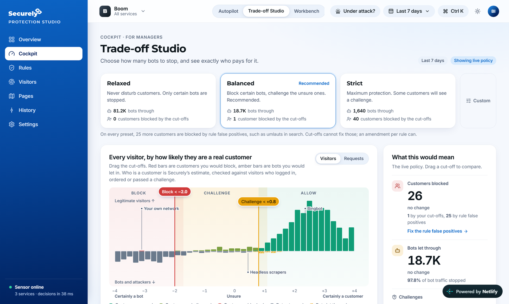
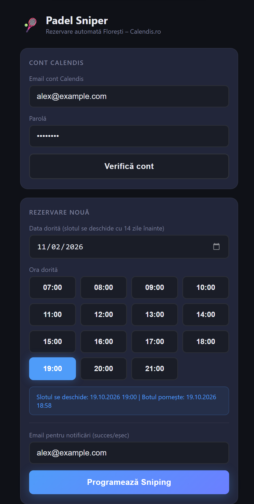
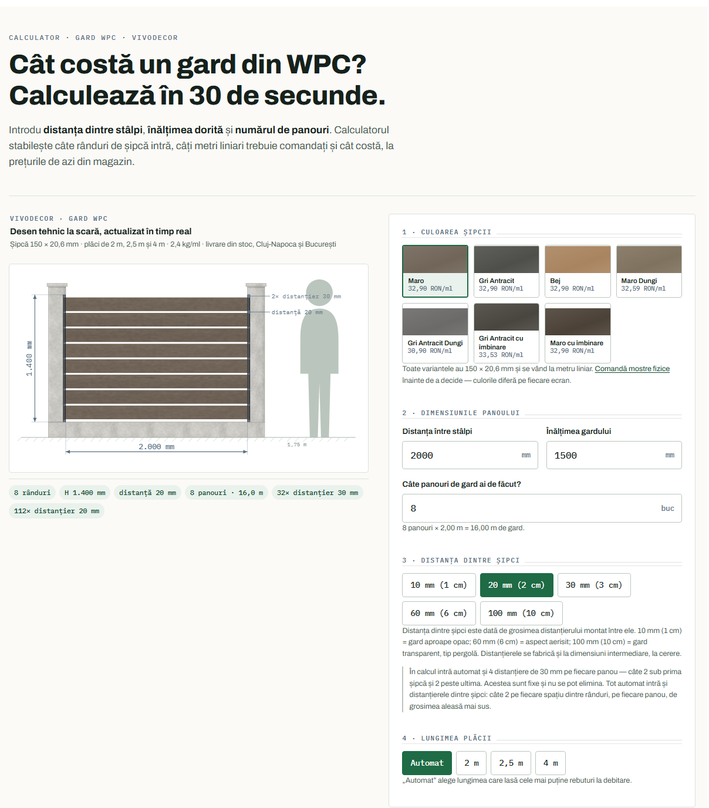

  

  Hi, I'm Alex 👋 · from Cluj, Romania · based in Eindhoven, NL

  
  

---

## 🙋 About me

- I like problems with real users. I've built a security prototype for a company, live price calculators for an online store, and a bot that books my padel court.
- I co-founded two FIRST robotics teams. At FRC we were the **first Romanian team ever to win an award at the World Championship**.
- 🔨 **Right now:** getting ready for **Junction 2026** (aiming for the Hardware Lab) and maintaining the VIVODECOR calculators.
- Outside code, I drive our FRC robot, mentor FIRST LEGO League kids and play padel (hence the bot).

---

## 🚀 Featured projects

### 🛡️ Protection Studio · [live demo ↗](https://legendary-strudel-73ee63.netlify.app/)

A take-home assignment for **Securely**, a web application firewall company. It helps their customers move from *watching* attacks to *blocking* them without blocking real customers.
- **Three cockpits for three audiences** (leadership, manager, engineer), all driven by one pure policy simulator. It replays ~1.2M requests in ~12 ms, so dragging a cut-off updates the impact live.
- Canary rollout with a circuit breaker, replay against last week's traffic, and per-rule amendments instead of disabling a rule.
- Policy as code: every version exports as JSON and ModSecurity rules. 73 unit tests.
- **Built in 5 days.** React · TypeScript · Vite · Zustand · Vitest

### 🎾 [Padel Sniper](https://github.com/AlexandruCiornai/Padel-Sniper)

The courts in my town open for booking exactly 14 days ahead, and the evening slots are gone in seconds. So I built a bot.

- You pick a date and hour on your phone.
- A headless browser logs in 2 minutes early, waits on the calendar page, and clicks the slot at exactly `hh:mm:00`.
- Live status reaches the phone over Socket.IO, and the result arrives by email.
- The timing is DST-safe, and access is PIN-protected with lockout.

Python · Flask · Playwright · APScheduler · Socket.IO

 

### 🧮 [VIVODECOR calculators](https://github.com/vivodecor/calculatoare) · [live ↗](https://www.vivodecor.ro/calculator-gard-wpc)

Price and quantity calculators for a Romanian store selling WPC fencing, cladding and decking. They run live on the store.
- They draw the fence to scale, with wood textures generated pixel by pixel and matched to product photos.
- Prices sync from the store, and customers can request a quote, send their configuration by WhatsApp or download a PDF.
- The store platform strips `<script>` tags, so the engines are served from GitHub via jsDelivr with versioned releases.
- Releases are checked by a jsdom regression suite. For the fence calculator, that means 88 configurations on desktop and mobile.

JavaScript · SVG/Canvas · Python build · Google Apps Script

---

## 🔧 Hardware & robotics

I'm happiest when the code moves something. At Junction I want to build in the **Hardware Lab**, where AI meets real hardware.

- **AlphaZ #11141 (FRC), co-founder.** I'm the driver, I wrote our custom driver-station dashboard, and I raised $61K+. Rookie All-Star at the **FIRST Championship 2026** in Houston, plus Rookie All-Star (Ankara) and the Quality Award (Başkent).
- **Alphatronic (FTC), co-founder and captain.** Inspire Award at Regional and National level, the Design Award at the FTC World Championship, and $185K+ raised over two seasons.
- **Embedded (AROBS internship).** Firmware in C for STM32 boards in Keil µVision and STM32CubeMX: integrating sensors and configuring peripherals.
- **Electronics (Bosch internship).** I designed and soldered a protection circuit that keeps 220 V away from the Bosch Learning Hub equipment. I also built a pneumatic football mini-game that the Hub still uses.
- **Mentoring.** I mentor the next Alphatronic team and FIRST LEGO League kids.

---

## 🏆 Hackathons

- **Cluj Hackathon ×3 (2023, 2024, 2025).** Each time, a 48-hour AI startup prototype built from scratch with two friends and pitched to mentors and investors. The latest is an AI tool that validates business ideas from market and competitor data and writes the business plan for a loan application.
- **Next: Junction 2026** in Espoo. 🛠️

---

## 🧰 Tech I use

  

Also Playwright, Zustand, Vitest, jsdom, APScheduler, STM32 (Keil, CubeMX) and WPILib.
